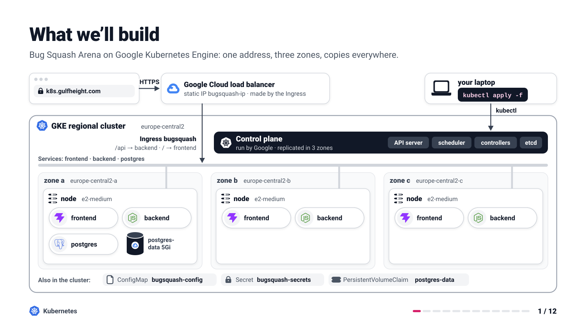

# Part 1: Quick revision (about 20 minutes)

[Game day](README.md) · **Part 1: Quick revision** · [Part 2: Incident theater →](2-incident-theater.md)

Before the incidents, make sure everyone has the fundamentals right. It's a rapid-fire round: read the
question aloud, let the room vote with their hands (A, B, C or D) or shout an answer, and only then
click **Answer**. Wrong answers are welcome: they show what to repeat.

> [!TIP]
> Keep it fast: about one minute per question. If more than a third of the room gets one wrong,
> spend an extra minute on it. That topic will come back in the incidents.

---

## Round 1: Containers

### 1. What is a container?

- **A)** A small virtual machine with its own operating system and kernel
- **B)** A normal process that the host's kernel isolates and limits
- **C)** The Dockerfile
- **D)** A zip file of the app

<b>Answer</b>

**B.** A container is just a process. The host kernel gives it walls (*namespaces*: its own view of
processes, network and files) and meters (*cgroups*: limits on CPU and memory). That's why containers
start in under a second, and why they all share **one** kernel.
[Containers and Docker, slides 3 and 6](../docs/containers-and-docker.md)

### 2. You run `docker run` three times on the same image. How many images and how many containers?

<b>Answer</b>

**1 image, 3 containers.** The image is the recipe (read-only), and each container is one cake baked from it.

### 3. Postgres runs in a container. You run `docker compose down`, then `up`. Are the players still there?

- **A)** Always
- **B)** Never
- **C)** Only if the data lives in a volume

<b>Answer</b>

**C.** A container's own filesystem is disposable; a **volume** survives it, like a USB stick you plug
into the new container. (`docker compose down -v` deletes the volumes too.)

---

## Round 2: CI/CD and Git

### 4. Every push runs lint, tests and a build. Is that CI or CD?

<b>Answer</b>

**CI, Continuous Integration:** every change is checked automatically, early and often.

**CD** is what happens after: **Continuous Delivery** means every passing build *could* go live with
one click, and **Continuous Deployment** means it goes live automatically. Our `ci-main.yml` builds and
pushes the images; with auto-deploy switched on, it is continuous deployment.

### 5. Why do we go `dev → test → main` instead of pushing straight to `main`?

<b>Answer</b>

Each branch is a gate. `dev` checks that the code is clean (lint, unit tests), `test` checks that the
whole system works (images built, integration tests), and only then `main` goes to production. A
mistake is caught where it is cheap, not in front of users.

### 6. Why do our images get a tag like `sha-dcb0790`, and not only `latest`?

<b>Answer</b>

`latest` changes every day, so it can't tell you **what** is running. `sha-dcb0790` names one exact git
commit, so you know which code runs where, and a rollback means "run the previous tag".

One catch: a tag is still a **label**, and whoever can push to the registry could move it. Only the
image **digest** (`image@sha256:…`) can never change. Our pipeline simply never reuses a `sha-` tag.

---

## Round 3: GitOps

### 7. In our Stage 4, GitHub Actions logs in to the VM over SSH and runs `deploy.sh`. Is that GitOps?

- **A)** Yes, it uses Git
- **B)** Not really: it is a CI pipeline *pushing* a deploy

<b>Answer</b>

**B.** In **GitOps**, Git holds the *desired state* of the whole system (for example our Kubernetes
manifests). An agent **inside** the cluster (Argo CD or Flux) keeps **pulling** from Git and makes the
cluster match it. Nobody logs in to deploy: you change the system with a pull request, and a rollback
is a `git revert`.

| | Our Stage 4 (push) | GitOps (pull) |
|---|---|---|
| Who deploys | the CI pipeline, from outside | an agent inside the cluster |
| Source of truth | the last deploy that ran | the Git repository, always |
| Manual change on the server | stays until the next deploy | undone within minutes |

### 8. In a GitOps cluster, someone runs `kubectl scale deployment/frontend --replicas=5` by hand. Git says 3. What happens?

<b>Answer</b>

The GitOps agent notices the **drift** and sets it back to **3**. You saw the same idea in
[Kubernetes Stage 3](../kubernetes/stages/stage-3-deployments.md): applying the file again brought 5 back to 3.
**The file is the truth**, not the last command someone typed.

---

## Round 4: Single points of failure

### 9. This is our system from the Docker stages. Point at every single point of failure.

<b>Answer</b>

A **single point of failure** (SPOF) is one part whose failure takes the whole system down.

- **The VM**: everything runs on it. If it stops, the site stops.
- **The database**: one container, one disk.
- **The proxy**: the only door. If it crashes, nobody gets in.

Restart policies help with crashes, but not with a dead machine.

### 10. Now our Kubernetes version. Three machines in three zones. Is there still a SPOF?

<b>Answer</b>

Yes: **Postgres**. It's one pod with one disk in **one zone**, and that disk can't move to another zone.
Stop that zone and the API waits. (The frontend and backend have 3 copies, and Google replicates the
control plane.) In production you would use a managed, replicated database such as Cloud SQL.

### 11. You have three replicas of the database. Someone runs `DELETE FROM users;`. Do the replicas save you?

<b>Answer</b>

**No.** Replication copies the mistake to every replica within milliseconds. **High availability**
protects you from *broken machines*; **backups** protect you from *broken data*. You need both.

---

## Round 5: Kubernetes in one minute

### 12. Match each word to its job.

| Word | Job |
|---|---|
| Pod | **A)** one stable name in front of changing copies |
| Deployment | **B)** the public door, routing by path |
| Service | **C)** the smallest thing Kubernetes runs |
| Ingress | **D)** keeps N copies alive and updates them one by one |

<b>Answer</b>

Pod → **C**, Deployment → **D**, Service → **A**, Ingress → **B**.

### 13. A pod fails its *readiness* probe. Another fails its *liveness* probe. What does Kubernetes do to each?

<b>Answer</b>

**Not ready** → no traffic is sent to it, but it keeps running (for example, it's still starting up).
**Not alive** → it is **restarted** (it's stuck).

### 14. During a rolling update, why don't players see errors?

<b>Answer</b>

Pods are replaced **one at a time**, and traffic goes only to pods that are **ready**. The old pods keep
serving until new ones can take over.

### 15. `kubectl get secret … -o yaml` shows `password: cGFzc3dvcmQ=`. Is that value encrypted?

<b>Answer</b>

**No.** It is only **base64-encoded**: `echo cGFzc3dvcmQ= | base64 -d` prints `password`. GKE encrypts
the disks underneath, but anyone **allowed to read** the Secret sees the value. So the real protection is
**who can read it** (access rules).

---

## Round 6: Secrets and infrastructure as code

### 16. Our pipeline pushes images to Docker Hub. Where does it keep the Docker Hub password, and who can read it?

<b>Answer</b>

In **GitHub Actions secrets** (`DOCKER_HUB_ACCESS_TOKEN`), never in the repository. GitHub hides the value
in the logs (`***`), but **every step of the job** can read it while it runs, including code that other
people wrote. And it's a token with an expiry date: when it expires, the pipeline stops. That happened to
our own `CD (main)` pipeline in November 2026.

### 17. We can delete our VM and rebuild everything with one Ansible command. What is that idea called, and why does it matter?

<b>Answer</b>

**Infrastructure as Code (IaC):** the server is described in files in Git, not built by hand. Every
change is reviewed like code, every rebuild is identical, and a broken server is replaced, not repaired
("cattle, not pets"). [Stage 5](../stages/stage-5-ansible.md).

---

**Everyone warmed up?** On to the real stories: [Part 2: Incident theater →](2-incident-theater.md)
